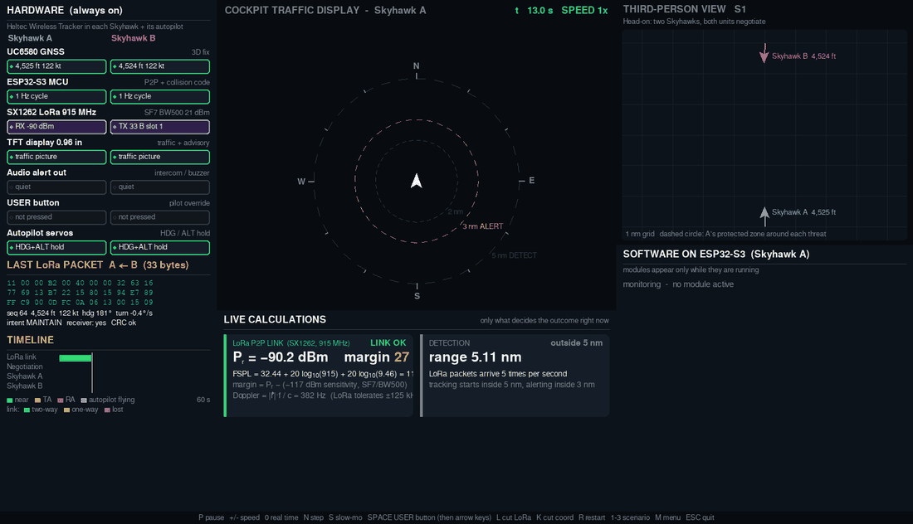
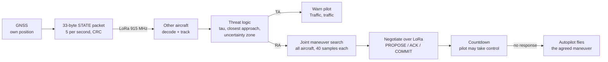
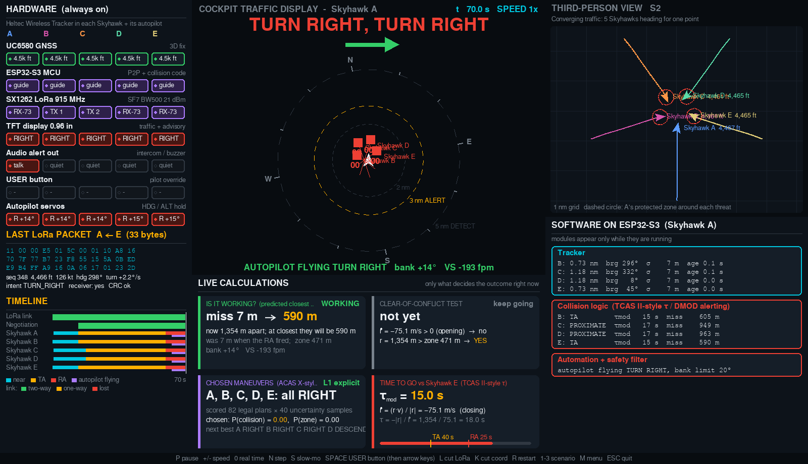
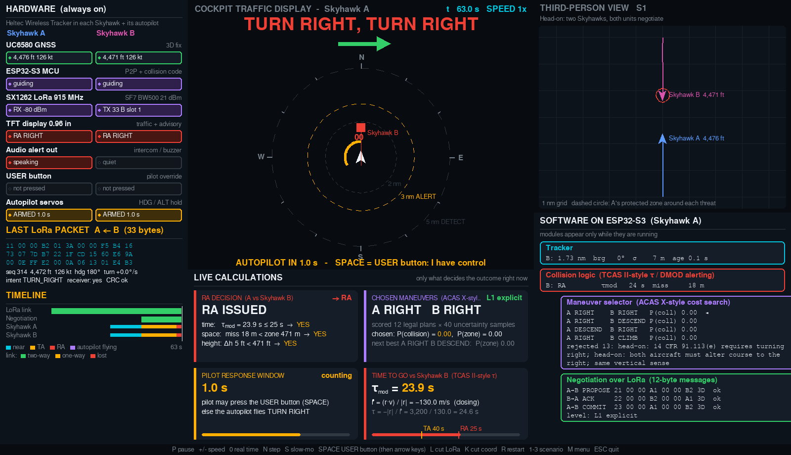
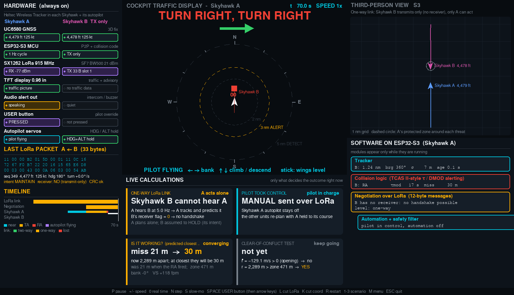
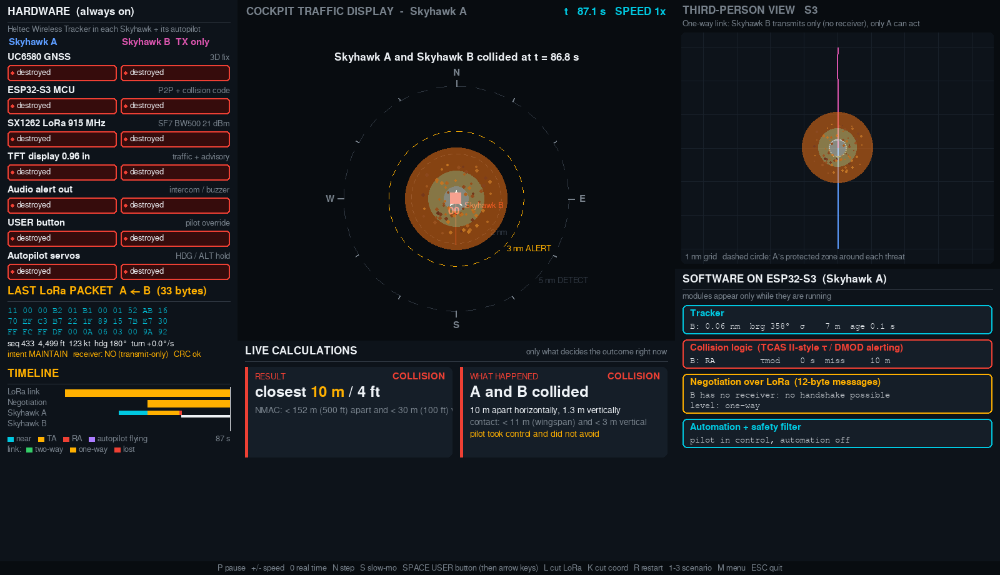
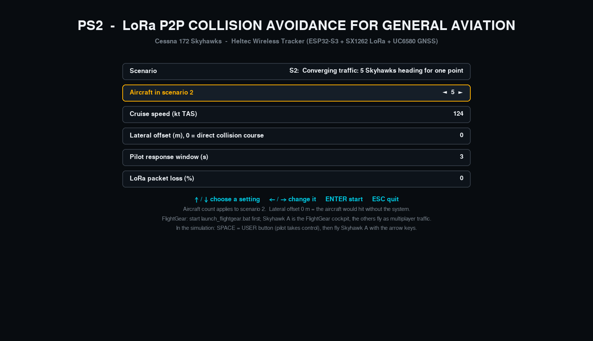

# Aviona: Peer-to-Peer Collision Avoidance for Small Aircraft

**Warn, negotiate, avoid.** A low-cost LoRa radio in each aircraft shares position and intent,
predicts conflicts, agrees with the other aircraft on who turns which way, warns the pilot, and lets
the autopilot avoid the collision if the pilot doesn't respond.

Built at the **Honeywell Aerospace × Devils Invent Hackathon 2026**, hosted by the **Ira A. Fulton
Schools of Engineering at Arizona State University**, for Problem Statement 2, *Automated TCAS for
General Aviation*. Team Aviona placed **5th**, one point from the final round.



*Scenario 1, head-on: detection at 5 nm, "Traffic, traffic" at 3 nm, "Turn right, turn right" with a
3-second pilot countdown, then the autopilot flies the turn. Every number on screen is computed live.*

---

## The problem

Airliners avoid each other with TCAS, which costs tens of thousands of dollars per aircraft, often
more than a small plane is worth. Light aircraft fly without it, mostly with one pilot scanning the
sky by eye. The General Aviation Joint Safety Committee recorded **43 midair collisions and 79 deaths
in US general aviation between 2016 and 2021**.

The challenge: design a peer-to-peer system for small aircraft that is low-cost, works at ranges up to
3 miles, warns the pilot, and, if the warning is ignored, avoids the collision through automated
negotiation between the aircraft.

## The idea

| | Existing GA systems (e.g. FLARM, ADS-B traffic displays) | Aviona |
|---|---|---|
| Detect and predict | Yes | Yes |
| Warn the pilot | Yes | Yes |
| **Coordinate** a maneuver with the other aircraft | No | **Yes, over a two-way LoRa link** |
| **Avoid** automatically if the pilot doesn't respond | No | **Yes, through the autopilot** |
| Hardware cost | Hundreds to thousands of dollars | ~$30 board per aircraft (Heltec Wireless Tracker) |

Each aircraft carries one **Heltec Wireless Tracker**: a UC6580 GNSS receiver (own position), an
SX1262 LoRa radio (915 MHz, peer-to-peer), and an ESP32-S3 processor (the collision logic).



## What the simulation shows

The simulation runs the onboard logic against real flight physics: **JSBSim**, the 6-DoF flight
model inside FlightGear, flying Cessna 172 Skyhawks at 124 knots, with **FlightGear** as the
cockpit and 3D view.

- **Real packet bytes.** Every aircraft encodes its state into a 33-byte packet with a CRC-16; the
  receiver decodes those bytes before using them. Coordination uses real 12-byte messages.
- **Live calculations.** Closing speed, time to collision (τ and TCAS-style modified τ), predicted
  closest approach along curved paths, an uncertainty zone that grows when packets go stale, the
  alert tests, and the maneuver chosen with its collision probability.
- **TCAS-style cockpit display** with hollow / filled diamonds, amber traffic advisories, red
  resolution advisories, voice callouts, and a countdown ring before the autopilot acts.
- **Hardware view.** Every component of each aircraft's board (GNSS, ESP32-S3, SX1262, display,
  audio, pilot button, autopilot servos) lights up as it works.
- **Failure cases.** Lost radio link, lost coordination messages, an aircraft that can only transmit,
  and a pilot who takes control and flies with the arrow keys. If aircraft actually collide, the
  simulation shows it.


*Five Skyhawks converging on one point: all are solved in one joint search and turn right together.*

## Results

Every scenario is a collision without the system. Closest approach with Aviona active:

| Scenario | Without Aviona | With Aviona |
|---|---|---|
| S1: head-on, two aircraft | Collision (8 m) | **947 m** apart |
| S2: three aircraft converging | Collisions | **823 m** minimum |
| S2: five aircraft converging | Collisions | **596 m** minimum |
| S3: other aircraft transmit-only (one-way link) | Collision (8 m) | **535 m**; only one aircraft can act |
| S3: pilot takes control and turns right | | **1,036 m** |
| S3: pilot takes control and does nothing | Collision | Collision (shown, with explanation) |

Ten-second takeaways:
- **Negotiated, both aircraft act:** ~950 m. **One-sided:** ~535 m. That gap is the case for two-way equipment.
- **All turn right** is not hard-coded. A Cessna can climb only ~130–230 ft in the time available,
  but a 15° turn moves it hundreds of meters, so the search picks turns, which also matches the
  right-of-way rules (14 CFR 91.113).

| | |
|---|---|
|  |  |
| Resolution advisory: the decisive equations and the chosen maneuver | One-way link: only Skyhawk A can act; the pilot is flying |
|  |  |
| The pilot took control and did not avoid | Start menu: scenario, number of aircraft, speed, offset, countdown, packet loss |

## Run it

Requires Python 3.10–3.12. FlightGear is optional.

```bash
cd sim
pip install -r requirements.txt
python run_demo.py --headless --all     # quick check: every scenario, text output
python run_demo.py --no-fg              # dashboard only
python run_demo.py                      # with FlightGear (start launch_flightgear.bat first)
```

Full Windows and FlightGear instructions, keys and parameters: **[docs/SETUP.md](docs/SETUP.md)**.

| Key | Action |
|---|---|
| `P`, `+` / `-`, `N` | Pause, speed 0.1×–16×, step one second |
| `SPACE`, arrow keys | Pilot takes control, then flies Skyhawk A |
| `L` / `K` | Cut the LoRa link / only the coordination messages |
| `1`–`3`, `M` | Scenario, start menu |

## Repository

```
sim/        simulation and onboard logic (Python)
  acas_core.py    threat logic and joint maneuver search
  tcas_node.py    one onboard unit: LoRa link, tracking, negotiation, countdown
  packet.py       33-byte state packet and 12-byte coordination messages, CRC-16
  sim.py          JSBSim Cessna 172s, GPS course hold, autopilot maneuvers, FlightGear output
  run_demo.py     scenarios, parameters, collision detection
  ui.py           start menu, dashboard, audio
docs/       setup guide, cost-to-market estimate, onboard computation (ESP32-S3) analysis
media/      demo GIF and screenshots
```

## Honest scope

This is a **simulation-validated prototype**, not certified avionics.

- **Real:** flight physics (JSBSim), the decision logic, packet encoding and decoding.
- **Simulated:** the radio channel, GNSS readings, and the autopilot interface.
- **Not yet done:** porting the logic to C++ on the ESP32-S3, real radio range tests, and
  hardware-in-the-loop testing with two real boards. There is no certified interface today for an
  add-on box to command a general aviation autopilot; the cost-to-market document outlines the
  certification path (portable advisory unit → FAA NORSEE installed unit → autopilot-coupled STC).
- The alerting is TCAS II-style and the maneuver search follows the ACAS X approach, but this is not
  TCAS or ACAS X, and the thresholds are configurable starting values.
- LoRa at 915 MHz is legal under FCC Part 15 but has no protection from interference; a product would
  need a protected band or a strong safety case.

## Team

| Team member | Role | Contributions |
|---|---|---|
| **Kamron Nazarov** | Simulation Lead | Flight simulation (JSBSim + FlightGear), onboard collision logic, LoRa packet protocol, live dashboard; presented the simulation |
| **Morteza Ghiyasi Varzaghan** | System Architecture & Business Lead | System architecture and information-flow diagram, existing-solutions analysis, cost and business opportunity; design feedback that shaped the simulation |
| **Di Lin** | Hardware & Communications Lead | Hardware selection (Heltec Wireless Tracker, ADS-B In options) and LoRa link verification |
| **Mobina Taghaddosi** | Problem Definition & Research Lead | Problem framing and outlook; research support for the architecture, cost and business slides |

Thanks to **K.C. Heun** and **Zhong Chen**, and to **Honeywell Aerospace** and the **ASU Ira A. Fulton
Schools of Engineering** (Devils Invent) for the event.

The simulation was developed with AI coding assistance (Anthropic's Claude). Its design, scenarios,
validation and testing were led by Kamron Nazarov, with design feedback from Morteza Ghiyasi Varzaghan.

## License

MIT, see [LICENSE](LICENSE).
